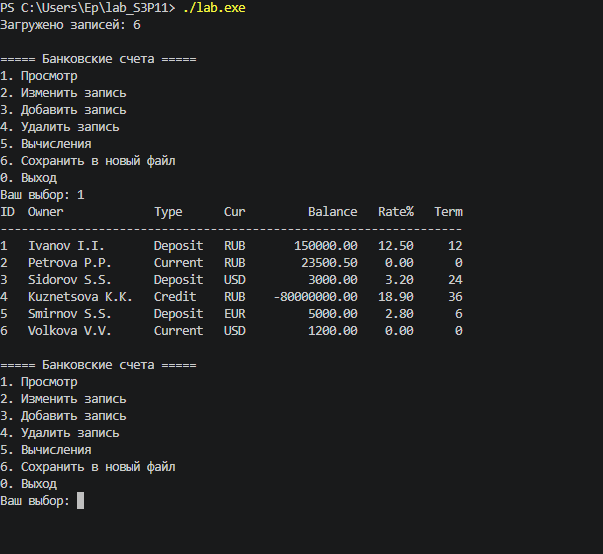
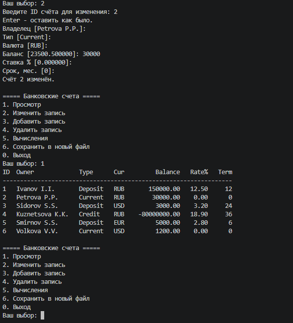
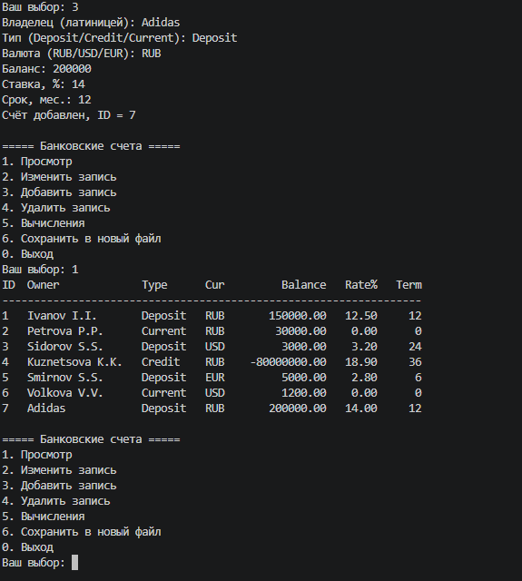
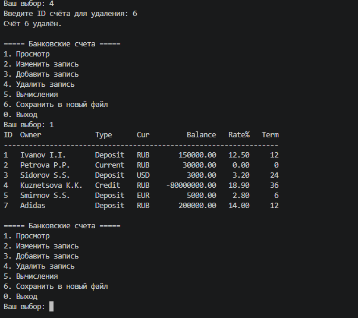
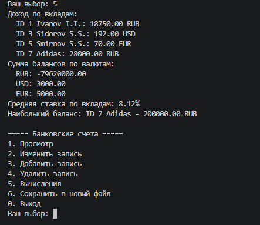
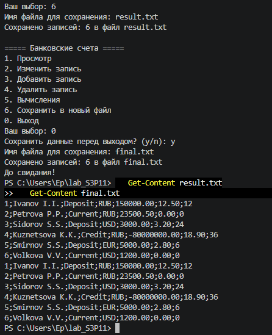

# S3P11 Структуры — вариант 17 «Банковское дело»

Исполнители: Петроченко Д., Стекачев И., Заровнятных Д. (ИКТГ-2521)

Программа хранит банковские счета в динамическом массиве структур `Account`, читает их из `data.txt` при запуске и работает через меню.

Сборка и запуск:
```
g++ main.cpp -o lab.exe
./lab.exe
```

## Работа программы

### 1. Чтение файла и просмотр данных


### 2. Корректировка записи


### 3. Добавление записи


### 4. Удаление записи


### 5. Вычисления


### 6. Сохранение в новый файл и сохранение при выходе

